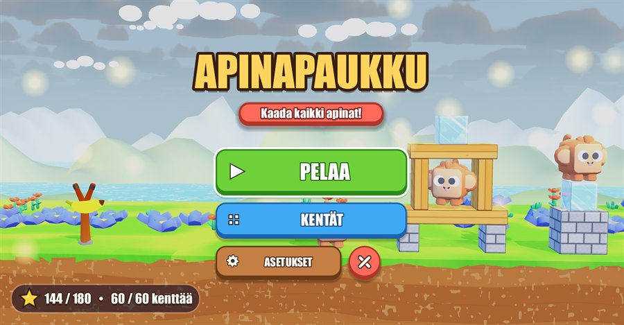
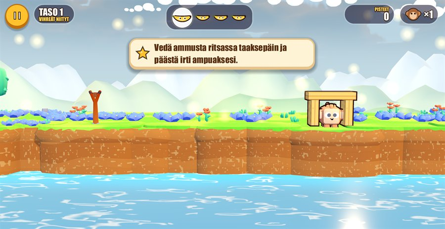
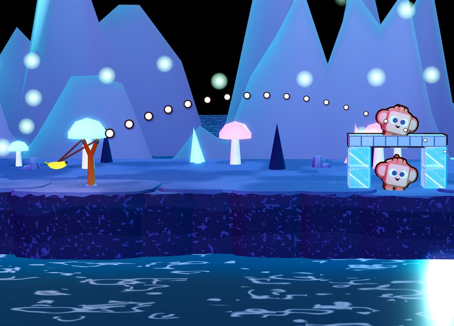
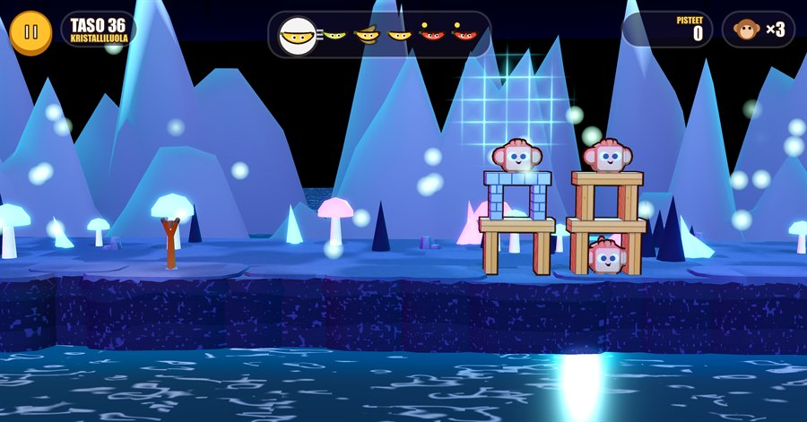
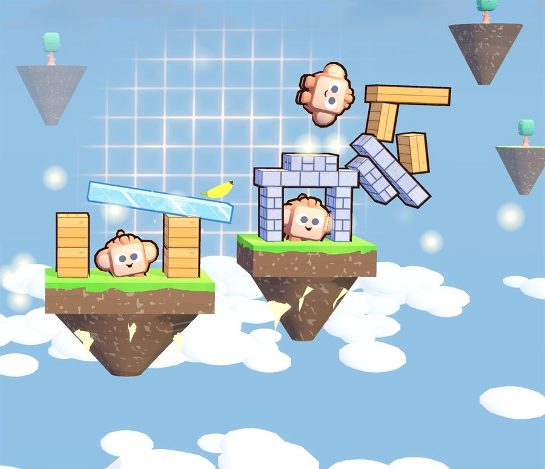
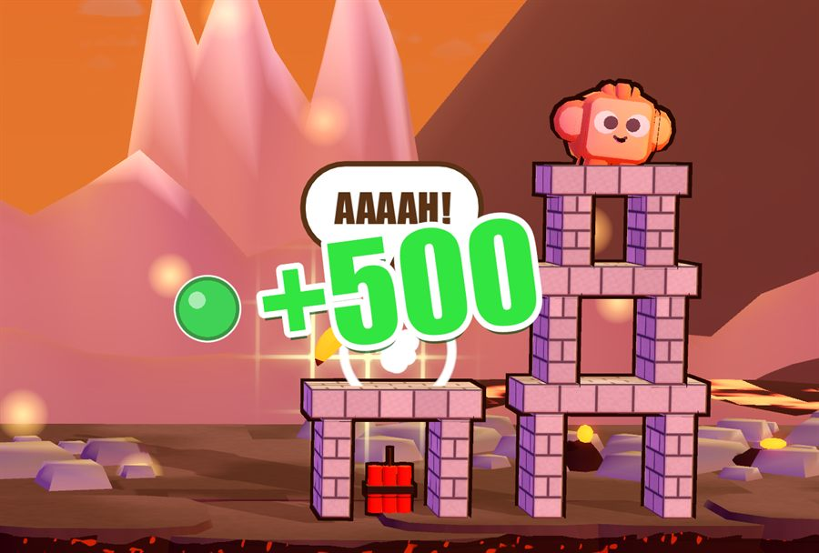
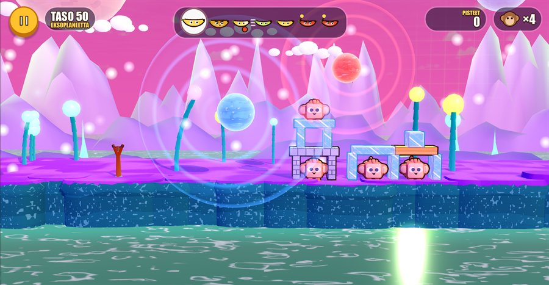
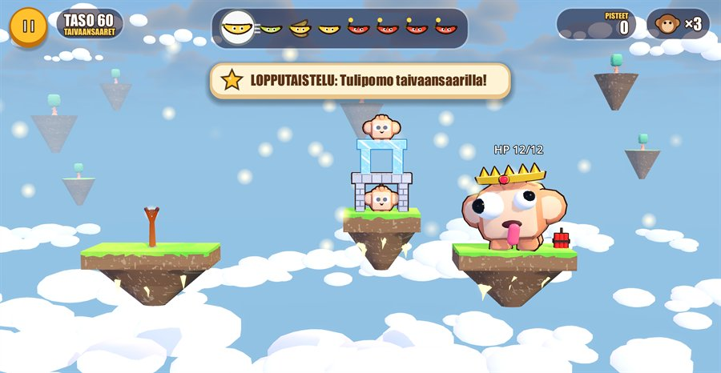

# 🐒 APINAPAUKKU

### Kaada kaikki apinat!

Ritsa, banaani ja kasa apinoita. **Apinapaukku** on fysiikkapeli, jossa virität ammuksen, tähtäät ja annat mennä — tavoitteena pudottaa kaikki apinat niiden omista linnoituksista.

**140 tasoa · 3 tähteä per taso · vaihtuvat maailmat · pomovastukset**

*Päävalikko: PELAA, KENTÄT ja ASETUKSET. Tähdet ja edistyminen pysyvät tallessa.*

---

## 🎯 Näin ammutaan

*Taso 1 opettaa perusliikkeen: vedä ammusta ritsassa taaksepäin ja päästä irti.*

Tähtäyspisteet näyttävät lentoradan, joten osuman voi hioa rauhassa ennen laukaisua. Mitä pidemmälle ammuksen vetää, sitä kovempi kyyti apinalle tulee.

*Vedä ja päästä – lentorata piirtyy näkyviin ennen laukaisua.*

---

## 🐵 Apinat, kilvet ja esteet

*Osa apinoista istuu kypärä päässä lasikuvun takana, osa rakennelmien sisällä.*

- Kypäräpäiset apinat kestävät enemmän kuin yhden osuman.
- Jääpalikat ja lasikuvut rikkoutuvat palasiksi.
- Rakennelmat on ladottu niin, että oikea osuma kaataa koko korttitalon.

---

## 💥 Fysiikka ja räjähdykset

*Osuma kohdalleen: torni romahtaa ja apinat lentävät.*

Jokainen laukaus vaikuttaa ympäristöön. Puiset telineet kaatuvat, kivirakenteet lohkeavat ja ruutilaatikot räjähtävät — ja pudonnut apina vie mukanaan seuraavan.

---

## 🍌 Pisteet, tähdet ja elämät

*Osumat ja pudotukset tuovat pisteitä – komeimmista suorituksista napsahtaa isompi potti.*

- **PISTEET** kertyvät oikeaan yläkulmaan.
- Ylhäällä keskellä on kolme tähteä, jotka voi kerätä jokaisesta tasosta.
- Elämät näkyvät apinan päänä oikeassa yläkulmassa.
- Tauko löytyy vasemmasta yläkulmasta.

---

## 🌌 Maailmat

*Eiplaneetta – neonvärit, jääpalikat ja kimppu apinoita yhdellä kentällä.*

Maisema vaihtuu tasojen myötä: vehreä niitty, kristalliluola, tulivuori, taivassaaret ja neonvärinen eiplaneetta. Jokaisessa maailmassa on oma tunnelmansa ja omat temppunsa.

---

## 👑 Pomovastukset

*Taivasareena ja pomovastus, jolla on oma HP-palkki (12/12).*

Kaikki apinat eivät kaadu yhdestä osumasta. Pomovastuksilla on oma kestävyyspalkkinsa, joten osumapaikka ja ajoitus pitää miettiä tarkemmin.

---

## 🕹️ Pelaaminen pähkinänkuoressa

1. Valitse taso **KENTÄT**-valikosta tai jatka **PELAA**-painikkeella.
2. Vedä ammusta taaksepäin ja päästä irti.
3. Tähtää rakenteisiin – pudota apinat ja säästä ammuksia.
4. Kerää kolme tähteä ja etene seuraavaan tasoon.

**Apinapaukku · Kaada kaikki apinat!**

